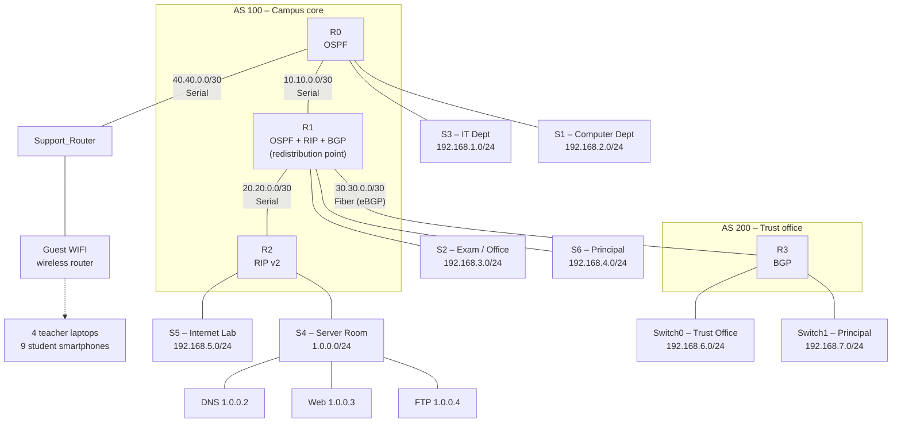

# Secure Enterprise Network – Cisco Packet Tracer

A multi-department enterprise / college campus network built in **Cisco Packet Tracer**. It combines **OSPF, RIPv2 and BGP** routing (with route redistribution), **router-based DHCP**, **DNS / Web / FTP servers**, a **wireless guest network**, and **SSH-based router management** across five routers, eight switches and roughly fifty end devices.

> **Project file:** `Project.pkt` (saved with Packet Tracer **9.0.1**)
> Everything in this document was read directly from the saved project file, so it reflects what is actually configured in the simulation.

---

## Table of Contents

1. [At a Glance](#at-a-glance)
2. [Network Topology](#network-topology)
3. [Device Inventory](#device-inventory)
4. [IP Addressing Plan](#ip-addressing-plan)
5. [Router Interface Map](#router-interface-map)
6. [Routing Design](#routing-design)
7. [DHCP](#dhcp)
8. [Servers and Network Services](#servers-and-network-services)
9. [Wireless Network](#wireless-network)
10. [Security Configuration](#security-configuration)
11. [How to Open and Use the Project](#how-to-open-and-use-the-project)
12. [Verification and Test Plan](#verification-and-test-plan)
13. [Known Issues and Improvement Roadmap](#known-issues-and-improvement-roadmap)
14. [Networking Reference](#networking-reference)
15. [Skills Demonstrated](#skills-demonstrated)
16. [Disclaimer](#disclaimer)

---

## At a Glance

| Item | Detail |
| --- | --- |
| Simulator | Cisco Packet Tracer (file version 9.0.1) |
| Routers | 5 × Cisco 1941 (`R0`, `R1`, `R2`, `R3`, `Support_Router`) |
| Switches | 7 × Catalyst 2960-24TT, 1 × generic Switch-PT |
| Servers | 3 (DNS, FTP, Web) |
| End devices | 27 PCs, 6 laptops, 9 smartphones |
| Wireless | 1 home/guest wireless router and 1 cell tower |
| Routing protocols | OSPF (process 1, area 0), RIP v2, BGP (AS 100 ↔ AS 200) |
| Internal domain | `enterprise.local` |
| Address assignment | DHCP served by the routers (one pool per department LAN) |
| Router management | SSH only on VTY lines, local user database, hashed enable secret |

---

## Network Topology



**Design summary**

* **R0** is the gateway for the IT and Computer departments.
* **R1** is the central router. It runs three routing protocols and redistributes between them, so every region can reach every other region. It also hosts the Exam/Office and Principal networks.
* **R2** serves the Internet Lab and the **Server Room**, which holds the DNS, Web and FTP servers.
* **R3** sits in a separate autonomous system and represents a remote Trust Office. It peers with R1 over eBGP across a fiber link.
* **Support_Router** connects to R0 on one side and to the guest wireless router on the other.

---

## Device Inventory

### Routers

| Name | Model | Role |
| --- | --- | --- |
| `R0` | Cisco 1941 | Gateway for IT and Computer departments, OSPF |
| `R1` | Cisco 1941 | Core router: OSPF, RIP v2, BGP AS 100, redistribution, Exam and Principal LANs |
| `R2` | Cisco 1941 | RIP v2 router for the Internet Lab and the Server Room |
| `R3` | Cisco 1941 | BGP AS 200, Trust Office and second Principal LAN |
| `Support_Router` | Cisco 1941 | Uplink toward the wireless guest router |

### Switches

| Name | Model | Connects to | Serves |
| --- | --- | --- | --- |
| `S1` | 2960-24TT | R0 `Gi0/0` | Computer Department |
| `S2` | 2960-24TT | R1 `Gi0/0` | Exam Cell / Office |
| `S3` | 2960-24TT | R0 `Gi0/1` | IT Department |
| `S4` | 2960-24TT | R2 `Gi0/1` | Server Room |
| `S5` | 2960-24TT | R2 `Gi0/0` | Internet Lab |
| `S6` | 2960-24TT | R1 `Gi0/1` | Principal's office |
| `Switch0` | 2960-24TT | R3 `Gi0/0` | Trust Office |
| `Switch1` | Switch-PT | R3 `Gi0/1` | Second Principal LAN |

### End devices by department

| Department | Switch | Subnet | Devices |
| --- | --- | --- | --- |
| IT Department | `S3` | `192.168.1.0/24` | HOD CABIN, IT LAB 1–4, PC18 |
| Computer Department | `S1` | `192.168.2.0/24` | CS HOD, CABIN 1, LAB 1–4 |
| Exam / Office | `S2` | `192.168.3.0/24` | Office PC1, Office PC2, Exam Cell PC, Enquiry PC, TPO PC |
| Principal | `S6` | `192.168.4.0/24` | PC0, Laptop0 |
| Internet Lab | `S5` | `192.168.5.0/24` | PC7, PC8, PC9, PC10, PC11 |
| Server Room | `S4` | `1.0.0.0/24` | DNS Server, Web Server, FTP Server, PC1 (static) |
| Trust Office | `Switch0` | `192.168.6.0/24` | TO1, TO2, TO3 |
| Principal (R3 side) | `Switch1` | `192.168.7.0/24` | Laptop1 |
| Wireless guests | Guest WIFI | `192.168.0.0/24` | Teacher 1–4 (laptops), Student 1–9 (smartphones) |

---

## IP Addressing Plan

### LAN networks

| Network | Subnet | Gateway | Served by |
| --- | --- | --- | --- |
| IT Department | `192.168.1.0/24` | `192.168.1.1` | R0 `Gi0/1` |
| Computer Department | `192.168.2.0/24` | `192.168.2.1` | R0 `Gi0/0` |
| Exam / Office | `192.168.3.0/24` | `192.168.3.1` | R1 `Gi0/0` |
| Principal | `192.168.4.0/24` | `192.168.4.1` | R1 `Gi0/1` |
| Internet Lab | `192.168.5.0/24` | `192.168.5.1` | R2 `Gi0/0` |
| Trust Office | `192.168.6.0/24` | `192.168.6.1` | R3 `Gi0/0` |
| Principal (R3) | `192.168.7.0/24` | `192.168.7.1` | R3 `Gi0/1` |
| Server Room | `1.0.0.0/24` | `1.0.0.1` | R2 `Gi0/1` |
| Guest / Support | `192.168.0.0/24` | `192.168.0.1` | Support_Router `Gi0/0` and Guest WIFI |

### Point-to-point links

| Link | Subnet | Side A | Side B | Media |
| --- | --- | --- | --- | --- |
| R0 ↔ R1 | `10.10.0.0/30` | R0 `Se0/1/0` – `10.10.0.1` | R1 `Se0/1/0` – `10.10.0.2` | Serial |
| R1 ↔ R2 | `20.20.0.0/30` | R1 `Se0/1/1` – `20.20.0.1` | R2 `Se0/1/1` – `20.20.0.2` | Serial |
| R1 ↔ R3 | `30.30.0.0/30` | R1 `Gi0/0/0` – `30.30.0.1` | R3 `Gi0/0/0` – `30.30.0.2` | Single-mode fiber |
| R0 ↔ Support_Router | `40.40.0.0/30` | R0 `Se0/1/1` – `40.40.0.1` | Support_Router `Se0/1/0` – `40.40.0.1` | Serial (see [Known Issues](#known-issues-and-improvement-roadmap)) |

### Static addresses (Server Room)

| Host | IP address | Mask | Gateway | DNS |
| --- | --- | --- | --- | --- |
| DNS Server | `1.0.0.2` | `255.255.255.0` | `1.0.0.1` | – |
| Web Server (HTTP/HTTPS) | `1.0.0.3` | `255.255.255.0` | `1.0.0.1` | `1.0.0.2` |
| FTP Server | `1.0.0.4` | `255.255.255.0` | `1.0.0.1` | `1.0.0.2` |
| PC1 | `1.0.0.5` | `255.255.255.0` | `1.0.0.1` | `1.0.0.2` |

All other hosts receive their addressing by DHCP.

---

## Router Interface Map

| Router | Interface | Address | Connected to |
| --- | --- | --- | --- |
| **R0** | `Gi0/0` | `192.168.2.1/24` | S1 – Computer Dept |
| | `Gi0/1` | `192.168.1.1/24` | S3 – IT Dept |
| | `Se0/1/0` | `10.10.0.1/30` | R1 |
| | `Se0/1/1` | `40.40.0.1/30` | Support_Router |
| **R1** | `Gi0/0` | `192.168.3.1/24` | S2 – Exam / Office |
| | `Gi0/1` | `192.168.4.1/24` | S6 – Principal |
| | `Gi0/0/0` | `30.30.0.1/30` | R3 (eBGP) |
| | `Se0/1/0` | `10.10.0.2/30` | R0 |
| | `Se0/1/1` | `20.20.0.1/30` | R2 |
| **R2** | `Gi0/0` | `192.168.5.1/24` | S5 – Internet Lab |
| | `Gi0/1` | `1.0.0.1/24` | S4 – Server Room |
| | `Se0/1/1` | `20.20.0.2/30` | R1 |
| | `Se0/1/0` | unused (shutdown) | – |
| **R3** | `Gi0/0` | `192.168.6.1/24` | Switch0 – Trust Office |
| | `Gi0/1` | `192.168.7.1/24` | Switch1 – Principal |
| | `Gi0/0/0` | `30.30.0.2/30` | R1 (eBGP) |
| **Support_Router** | `Gi0/0` | `192.168.0.1/24` | Guest WIFI (internet port) |
| | `Se0/1/0` | `40.40.0.1/30` | R0 |
| | `Gi0/1` | unused (shutdown) | – |

---

## Routing Design

The network intentionally mixes three routing protocols so that route redistribution can be studied end to end.

```text
   OSPF area 0                 RIP v2                 eBGP
 ┌──────────────┐        ┌───────────────┐      ┌──────────────┐
 │  R0 ── R1    │        │   R1 ── R2    │      │  R1 ── R3    │
 │ 10.10.0.0/30 │        │ 20.20.0.0/30  │      │ 30.30.0.0/30 │
 └──────────────┘        └───────────────┘      └──────────────┘
          └──────────── R1 redistributes between all three ────────┘
```

### OSPF (process 1, area 0) – R0 and R1

| Router | Networks advertised |
| --- | --- |
| R0 | `10.10.0.0/30`, `192.168.1.0/24`, `192.168.2.0/24` |
| R1 | `10.10.0.0/30`, `192.168.3.0/24`, `192.168.4.0/24` |

R1 additionally redistributes **RIP** and **BGP** routes into OSPF (`redistribute rip subnets`, `redistribute bgp 100 subnets`), so R0 learns routes to R2's and R3's networks.

### RIP v2 – R1 and R2

| Router | Configuration |
| --- | --- |
| R1 | `network 20.0.0.0`, `redistribute ospf 1 metric 2`, `default-information originate`, `no auto-summary` |
| R2 | `network 1.0.0.0`, `network 20.0.0.0`, `network 192.168.5.0`, `no auto-summary` |

R1 injects a default route plus the OSPF-learned routes into RIP, which gives R2 reachability toward the rest of the campus.

### BGP – R1 (AS 100) and R3 (AS 200)

| Router | Configuration |
| --- | --- |
| R1 | `router bgp 100`, neighbor `30.30.0.2` remote-as `200`, advertises the campus LANs and the transit links, `redistribute ospf 1` |
| R3 | `router bgp 200`, neighbor `30.30.0.1` remote-as `100`, advertises `192.168.6.0` and `192.168.7.0` |

### Routing summary

| Router | Protocols |
| --- | --- |
| R0 | OSPF |
| R1 | OSPF, RIP v2, BGP (redistributing between them) |
| R2 | RIP v2 |
| R3 | BGP |
| Support_Router | Directly connected networks only (no routing protocol configured) |

---

## DHCP

DHCP is served **by the routers**, one pool per LAN. Each pool reserves the first 20 addresses (`.1`–`.20`) for infrastructure.

| Router | Pool | Network | Default gateway | DNS | Domain |
| --- | --- | --- | --- | --- | --- |
| R0 | `IT` | `192.168.1.0/24` | `192.168.1.1` | `1.0.0.2` | `enterprise.local` |
| R0 | `COMPUTER` | `192.168.2.0/24` | `192.168.2.1` | `1.0.0.2` | `enterprise.local` |
| R1 | `EXAM` | `192.168.3.0/24` | `192.168.3.1` | `1.0.0.2` | `enterprise.local` |
| R1 | `PRINCIPAL` | `192.168.4.0/24` | `192.168.4.1` | `1.0.0.2` | `enterprise.local` |
| R2 | `INTERNET` | `192.168.5.0/24` | `192.168.5.1` | `1.0.0.2` | `enterprise.local` |
| R3 | `TRUST_OFFICE` | `192.168.6.0/24` | `192.168.6.1` | `1.0.0.2` | `enterprise.local` |
| R3 | `PRINCIPAL` | `192.168.7.0/24` | `192.168.7.1` | `1.0.0.2` | `enterprise.local` |

Wireless clients receive their addresses from the **Guest WIFI** router (see [Wireless Network](#wireless-network)).

---

## Servers and Network Services

All three servers sit in the Server Room (`1.0.0.0/24`) behind R2.

### DNS Server – `1.0.0.2`

Authoritative for the internal `enterprise.local` zone:

| Record type | Name | Address |
| --- | --- | --- |
| A | `dns.enterprise.local` | `1.0.0.2` |
| A | `www.enterprise.local` | `1.0.0.3` |
| A | `ftp.enterprise.local` | `1.0.0.4` |

Every DHCP pool hands out `1.0.0.2` as the DNS server, so clients on any LAN can resolve these names.

### Web Server – `1.0.0.3`

* HTTP and HTTPS services enabled
* Hosts a custom `project.html` page alongside the default Packet Tracer pages
* Reached through `www.enterprise.local`

### FTP Server – `1.0.0.4`

* FTP service enabled with user accounts for file transfer
* Reached through `ftp.enterprise.local`

### Other

* `PC1` (`1.0.0.5`) is a statically addressed client in the Server Room, handy for testing without depending on DHCP.
* Packet Tracer's built-in server services (email, NTP, TFTP, syslog) are present on the servers at their default settings but are not part of the core design.

---

## Wireless Network

| Setting | Value |
| --- | --- |
| Access device | `Guest WIFI` (HomeRouter-PT-AC) |
| Uplink | Support_Router `Gi0/0` (`192.168.0.1/24`) |
| SSID | `Default` |
| Security | None (open network) |
| SSID broadcast | Enabled |
| MAC filtering | Disabled |
| DHCP | Pool starting at `192.168.0.100`, up to 50 users |
| Clients | Teacher 1–4 (laptops), Student 1–9 (smartphones) |

A cell tower is also present in the topology for mobile-network demonstrations.

---

## Security Configuration

### Implemented

| Control | Where | Detail |
| --- | --- | --- |
| Hashed privileged password | R0, R1, R2, R3 | `enable secret` (MD5, type 5) |
| Local user accounts | R0, R1, R2, R3 | Each router has a local username with a hashed secret |
| **SSH-only remote access** | R0, R1, R2, R3 | `line vty 0 4` and `5 12` use `login local` and `transport input ssh`; Telnet is not permitted |
| Domain name for SSH keys | All routers | `ip domain-name` configured; RSA keys generated on R2 and R3 |
| Network segmentation | Whole network | Each department sits in its own routed subnet |
| Disabled unused interfaces | R0–R3, Support_Router | `Vlan1` shut down; unused serial and gigabit ports shut down |

### Not configured in the current project file

The following are common enterprise controls that are **not** present in the saved project. They are listed so the scope of the lab is clear, and they appear in the roadmap below:

* Access control lists (ACLs) between departments
* VLANs, trunking and port security on the switches
* NAT / PAT, zone-based firewall, VPN / IPsec
* AAA, logging and SNMP hardening
* Wireless encryption on the guest network

---

## How to Open and Use the Project

1. Install **Cisco Packet Tracer 9.0 or later** (the file was saved with 9.0.1; older versions may not open it).
2. Clone the repository:

   ```bash
   git clone https://github.com/atharvaphalke-03/secure-enterprise-network-packet-tracer.git
   cd secure-enterprise-network-packet-tracer
   ```
3. Open `Project.pkt` in Packet Tracer (File → Open).
4. Wait for the routing protocols to converge (a few seconds in real-time mode, or use the fast-forward button), then run the tests below.

### Repository contents

```text
.
├── Project.pkt    # Packet Tracer simulation file
└── README.md      # This document
```

---

## Verification and Test Plan

### Router checks (CLI)

```cisco
show ip interface brief
show ip route
show ip protocols
show ip ospf neighbor          ! R0 and R1
show ip rip database           ! R1 and R2
show ip bgp summary            ! R1 and R3
show ip dhcp binding           ! R0, R1, R2, R3
show running-config
```

### End-to-end tests

| # | Test | From | Expected result |
| --- | --- | --- | --- |
| 1 | DHCP lease | Any PC | IP, mask, gateway and DNS `1.0.0.2` assigned automatically |
| 2 | Same-LAN ping | PC → PC in the same department | Replies |
| 3 | OSPF path | IT PC → Computer Dept PC (`R0`) | Replies |
| 4 | Campus path | IT PC → Exam Office PC (`R0 → R1`) | Replies |
| 5 | RIP path | IT PC → Internet Lab PC (`R0 → R1 → R2`) | Replies |
| 6 | eBGP path | IT PC → Trust Office PC (`R0 → R1 → R3`) | Replies |
| 7 | DNS | Any PC: `ping www.enterprise.local` | Resolves to `1.0.0.3` |
| 8 | Web | Browser → `http://www.enterprise.local` and `https://…` | Page loads |
| 9 | FTP | PC command prompt: `ftp ftp.enterprise.local` | FTP login prompt |
| 10 | SSH | PC command prompt: `ssh -l <user> 192.168.x.1` | Prompt for credentials |
| 11 | Telnet blocked | `telnet 192.168.x.1` | Connection refused |
| 12 | ARP | `arp -a` after a ping | Gateway MAC listed |
| 13 | Wireless | Teacher / Student device | Receives `192.168.0.x` address |

### Packet Tracer simulation mode

Switch to **Simulation** mode and filter on `ARP`, `ICMP`, `DNS`, `DHCP`, `HTTP`, `FTP` and `SSH` to watch each protocol travel through the OSI layers, hop by hop.

---

## Known Issues and Improvement Roadmap

### Issues found in the current file

| # | Observation | Suggested fix |
| --- | --- | --- |
| 1 | **Duplicate IP**: R0 `Se0/1/1` and Support_Router `Se0/1/0` are both `40.40.0.1/30` | Change the Support_Router side to `40.40.0.2/30` |
| 2 | Support_Router has no routing protocol, default route, DHCP or secured VTY access, so the guest network is not reachable from the campus | Add a default or static route and an OSPF adjacency on the `40.40.0.0/30` link |
| 3 | The `40.40.0.0/30` link and `192.168.0.0/24` are not advertised into OSPF | Add them to R0's OSPF configuration |
| 4 | The guest Wi-Fi uses the default SSID with **no encryption** | Set a unique SSID and WPA2-PSK |
| 5 | `service password-encryption` is off, so VTY line passwords are stored in plain text | Enable it, or remove line passwords since `login local` is used |
| 6 | Switches still use the default hostname `Switch` and have no VLANs or port security | Name the switches, add VLANs and port security |
| 7 | Default FTP credentials are in use on the servers | Replace with strong, unique accounts |
| 8 | Some BGP `network` statements use classful forms without masks | Specify exact masks so prefixes match the routing table |

### Roadmap

* [ ] Fix the duplicate `40.40.0.1` address and bring the guest network into the routing domain
* [ ] Add **extended ACLs** (for example, students and guests blocked from the Principal and Server networks)
* [ ] Introduce **VLANs** with 802.1Q trunking and a router-on-a-stick or Layer 3 switch design
* [ ] Add **port security**, DHCP snooping and BPDU guard on access ports
* [ ] Configure **NAT/PAT** and a default route toward a simulated ISP
* [ ] Add a **site-to-site IPsec VPN** between the campus and the Trust Office
* [ ] Add **AAA**, syslog and NTP-synchronised logging
* [ ] Replace redistribution with a cleaner design (single IGP plus BGP at the edge)
* [ ] Add IPv6 addressing alongside IPv4

---

## Networking Reference

### Ports and services used in this project

| Service | Protocol | Port |
| --- | --- | ---: |
| FTP | TCP | 21 |
| SSH | TCP | 22 |
| DNS | UDP / TCP | 53 |
| DHCP server | UDP | 67 |
| DHCP client | UDP | 68 |
| HTTP | TCP | 80 |
| BGP | TCP | 179 |
| HTTPS | TCP | 443 |
| RIP | UDP | 520 |
| OSPF | IP protocol 89 | – |
| ICMP | IP protocol 1 | – |

### OSI and TCP/IP mapping

```text
OSI                 TCP/IP             Used in this project
------------------  -----------------  ----------------------------------
Application         Application        HTTP, HTTPS, DNS, FTP, DHCP, SSH
Presentation        Application        TLS (HTTPS), SSH encryption
Session             Application        Session handling for FTP / SSH
Transport           Transport          TCP, UDP
Network             Internet           IPv4, ICMP, OSPF, RIP, BGP
Data Link           Network Access     Ethernet, ARP, MAC addressing
Physical            Network Access     Copper, serial and fiber links
```

---

## Skills Demonstrated

**Network design:** hierarchical campus design, IPv4 addressing, /24 and /30 subnetting, multi-site topology

**Routing:** OSPF, RIP v2, eBGP, multi-protocol route redistribution, default-route origination

**Network services:** router-based DHCP, DNS zone records, HTTP/HTTPS, FTP, wireless access

**Security:** SSH-only management, hashed secrets, local authentication, interface hardening, security-gap analysis

**Troubleshooting:** connectivity testing, routing-table inspection, neighbor verification, packet-level analysis in simulation mode

**Tools:** Cisco Packet Tracer, Cisco IOS CLI

---

## Disclaimer

This project is developed for **educational and authorized networking/security learning purposes**. All activity takes place inside a simulated, controlled lab environment.
